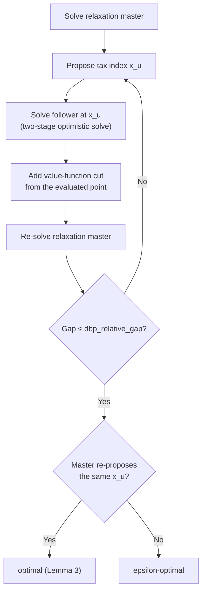

# CLSC Network Design under Carbon Pricing — Bilevel Mixed-Integer Program

Exact (or ε-optimal, with a certified gap) solutions to a bilevel closed-loop supply chain design problem under a carbon tax, via the Deterministic Bounding Procedure of Soares et al. (2021).


<!-- TODO: add a CI workflow (.github/workflows/) and swap the tests badge for a real one; no workflow exists in the repo today. -->

<!-- TODO: choose a licence (e.g. MIT / Apache-2.0 / BSD-3-Clause), add a LICENSE file, and set `license` in pyproject.toml. No licence has been chosen yet; until one is added, the code is not licensed for reuse. -->

## What this is

This repository solves a two-level decision problem: a regulator sets a carbon tax, and a closed-loop supply chain (CLSC) operator redesigns and runs its network — which facilities to open, which technologies to install, how to route forward and reverse flows — in response. The regulator anticipates that response and picks the tax accordingly, so the whole thing is a bilevel mixed-integer program, not two independent problems.

The repository provides an exact(-or-certified) solver for this bilevel problem, a deterministic generator that produces reproducible benchmark instances, and the 15 instances it has already generated. It targets researchers who need a reference implementation to build on, extend, or benchmark against.

## Key features

- Bilevel carbon-tax model of a multi-period, multi-product closed-loop supply chain (facility location, technology selection, capacities, transport modes, forward and reverse flows), formulated as a mixed-integer linear program on the follower side.
- Deterministic Bounding Procedure (DBP) solver (Soares, Alves and Henggeler Antunes, 2021): a relaxation master with value-function cuts closes a certified gap between a lower and an upper bound on the leader's objective.
- Optimistic two-stage tie-break on the follower's side (minimise cost-plus-tax, then minimise physical emissions among the cost-optimal responses).
- Fallback handling for subproblems that hit their time limit (follower-improvement subproblem P6, elastic value-function cuts P5-D), so the run still returns a certified — if looser — bound instead of failing.
- Deterministic instance generator, based on published sampling rules, reproducing a committed 15-instance benchmark set from seeds.
- Structured, revalidated output per run: a machine-readable summary, the full result with bound certificates, the incumbent solution, a per-iteration trace, and a manifest of the configuration used.

## Quickstart

```bash
git clone https://github.com/marceloalmeidapinto1998/bilevel-clsc-carbon-pricing.git
cd bilevel-clsc-carbon-pricing
python -m venv .venv
source .venv/bin/activate          # Windows: .venv\Scripts\activate
pip install -e ".[dev]"
```

This installs the `clsc` package and two commands, `clsc-solve` and `clsc-generate` (`python -m clsc.solver_cli` and `python -m clsc.generator` are equivalent to them). Solving requires a valid Gurobi licence — see [Reproducibility and requirements](#reproducibility-and-requirements).

```bash
clsc-solve data/STD_I17_M4_T3.json --results-root results/runs
```

Output lands in `results/runs/<dataset>/<instance>/dbp/`, as `summary.json`, `summary.csv`, `result.json`, `solution.json`, `dbp_trace.csv` and `manifest.json` — see [Usage](#usage) for what each file contains.

## Problem in brief

| | Leader (regulator) | Follower (CLSC operator) |
|---|---|---|
| Decision | tax index $x_u$ | network design and period-by-period operation $y$ |
| Objective | minimise $F(x_u, y)$ | minimise $f(x_u, y)$, for the leader's fixed $x_u$ |
| Problem class | outer, integer | inner, mixed-integer linear program |

**Notation**, defined once and reused below:

- $x_u \in \{0, 1, \dots, \bar{x}_u\}$ — the leader's decision, the integer tax index (`tax_index` in the code); $\bar{x}_u$ is instance-specific ($\bar{x}_u = 200$ on the benchmark instances).
- $\tau = \theta \, x_u$ — the carbon tax rate; $\theta = 10^{-3}$ USD/kg CO₂e (`TAX_SCALE_FACTOR`) is the grid step, so each unit of $x_u$ is 1 USD/t CO₂e.
- $y$ — the follower's response (the whole network design and operating plan).
- $E(y)$ — the follower's total physical emissions (kg CO₂e).
- $\beta(y)$ — the emissions aggregate the follower is actually taxed on. $\beta(y) = E(y)$ only when the instance carries no interest rate; the benchmark instances are generated with one, so in general $\beta(y) \neq E(y)$ (see <a href="#details-problem">details</a> below).
- $c(y)$ — the follower's discounted operating cost.
- $w > 0$ — the leader's policy weight on the tax term, in kg CO₂e per tax increment; by default $w = q \, E_{\text{ref}}$, with $q = 10^{-4}$ (`tax_weight_relative`) and $E_{\text{ref}}$ the minimum emissions level attainable in the cut-free relaxation master.

The leader minimises

$$F(x_u, y) = E(y) + w \, x_u$$

and the follower, for a fixed $x_u$, minimises

$$f(x_u, y) = c(y) + \tau \cdot \beta(y)$$

<details id="details-problem">
<summary>Full problem statement (leader and follower, in detail)</summary>

**Leader problem.** The weight $w$ represents the emissions the regulator would accept in exchange for a tax rate one step lower; it can also be fixed directly, in kg CO₂e per USD/t, instead of being derived from $q$ and $E_{\text{ref}}$. Since $w > 0$, the lowest tax is selected among those yielding equal emissions, so no secondary tie-break criterion is needed on the leader's side.

**Follower problem.** For a fixed tax index, the follower solves a mixed-integer linear program over a multi-period, multi-product CLSC network of suppliers, factories, warehouses, retailers and airport/seaport hubs, connected by truck, air and sea transport. Its decisions are:

- strategic: which factories and warehouses to open, their installed floor-area capacities, and which production and remanufacturing technologies to install at each factory;
- tactical/operational, period by period: raw-material purchases from suppliers, production and remanufacturing volumes, warehouse inventory levels, and forward flows of final products and reverse flows of recovered products across the network's transport arcs and modes.

$c(y)$ covers procurement, production, remanufacturing, transport, handling and inventory, discounted over the planning horizon. $\beta(y)$ is the same emissions quantity as $c(y)$'s cost terms, discounted with the same present-value weights, which is why it generally differs from the leader's undiscounted $E(y)$.

</details>

## Method

The bilevel problem is solved with the **Deterministic Bounding Procedure (DBP)** of Soares, Alves and Henggeler Antunes (2021):

1. Solve the relaxation master — the leader's objective $F$ minimised over the follower's physical constraints only, independent of the tax — to get a lower bound on $F$ and a proposed $x_u$.
2. Solve the follower's MILP at that $x_u$ (two-stage optimistic solve — see <a href="#details-method">details</a>) to get an evaluated response $y_k$, hence an upper bound on $F$.
3. Add a value-function cut built from $(x_u, y_k)$ to the master: $f(x,y) \le f(x,y_k) + \varepsilon'$, valid at every tax index since the follower's constraints do not depend on it.
4. Re-solve the master with the new cut.
5. Stop once the relative gap $(\mathrm{UB}-\mathrm{LB})/\max(1,|\mathrm{UB}|) \le$ `dbp_relative_gap` (default $10^{-4}$); otherwise return to step 2 with the master's new proposal.



<details id="details-method">
<summary>Tie-breaking, time-limit fallbacks and tolerances</summary>

**Tie-breaking.** Among the responses that minimise $f$, the follower is assumed to pick the one with least physical emissions $E$ — the optimistic rule — enforced by a two-stage lexicographic solve. Stage 1 minimises $f$, giving $f^*$. Stage 2 re-minimises $E$ subject to $f \le f^* + \varepsilon'$, where $\varepsilon'$ (`lex_epsilon_prime`, $10^{-6}$ relative, floored at an absolute $10^{-7}$) freezes Stage 1's value within a numerical tolerance before re-optimising. If Stage 1 stops at its time limit, subproblem (P6) first searches for a response that improves on it before the freeze is set; if Stage 2 finds nothing feasible, the Stage-1 (or P6) response is kept.

**Subproblems that time out.** A master that times out still yields a valid dual bound and a usable tax proposal; a follower that times out is passed through subproblem (P6); and the master's cuts are made elastic (P5-D) the first time it returns no feasible point. The result is reported **optimal** if the gap has closed and the master re-proposes the tax index just evaluated (Lemma 3 of the reference); otherwise it is **epsilon-optimal**.

</details>

## Benchmark instances

The repository includes a deterministic instance generator, based on the sampling rules of Tautenhain, Barbosa-Póvoa, Mota and Nascimento (2021), for the CLSC model of Mota, Gomes, Carvalho and Barbosa-Póvoa (2018), and the 15 instances it has already generated. Instances are named `STD_I<entities>_M<materials>_T<periods>`.

| Set | `I` (total entities) | `M` (materials code) | `T` (periods) | Count | Purpose |
|---|---|---|---|---|---|
| Standard testbed | 17, 25 | 4, 8 | 3, 6, 12 | 12 (every combination) | Main benchmark set |
| Escalation | 25, 25, 33 | 12, 16, 8 | 6, 6, 6 | 3 | Scalability probes, one axis pushed past the standard range |

`I` counts suppliers, factories, warehouses, retailers, airports and seaports together. `M4` corresponds to 2 raw materials and 1 product; `M8` to 4 raw materials and 2 products.
<!-- FLAG: the M code does not equal raw_materials + products (M4 -> 2+1=3, M8 -> 4+2=6); see open question C1. Not corrected here per instructions — confirm the intended meaning of the M code before publishing. -->

The escalation instances (`STD_I25_M12_T6`, `STD_I25_M16_T6`, `STD_I33_M8_T6`) are not written by the routine `benchmark` command — generate them explicitly with `escalation` (see [Usage](#usage)). Every instance, standard or escalation, uses 3 production and 3 remanufacturing technologies.

## Usage

### Solve instances

```bash
# one instance, default configuration
clsc-solve data/STD_I17_M4_T3.json --results-root results/runs

# every instance in a folder
clsc-solve data --results-root results/runs

# a different tax weight (see Configuration)
clsc-solve data/STD_I17_M4_T3.json --leader-tax-weight-relative 1e-5
```

Each instance writes to `results/runs/<dataset>/<instance>/dbp/`:

| File | Content |
|---|---|
| `summary.json`, `summary.csv` | result class, termination reason, tax, cost, emissions, bounds, gap, validation status |
| `result.json` | full result: bounds with certificates, follower stage gaps, timings |
| `solution.json` | the incumbent's variable values |
| `dbp_trace.csv` | one row per DBP iteration: proposed tax, bounds, subproblem times |
| `manifest.json` | configuration used: tolerances, time limits, tax weight, flags |

`clsc-solve --help` lists every option.

<!-- TODO: add an example `summary.json` (or excerpt) once a representative, citable run is agreed on. No example output was provided in the source material for this rewrite. -->

### Generate instances

```bash
# the 12-instance benchmark (I in {17, 25} x M in {4, 8} x T in {3, 6, 12})
clsc-generate benchmark --output-dir data

# the three escalation instances (STD_I25_M12_T6, STD_I25_M16_T6, STD_I33_M8_T6)
clsc-generate escalation --output-dir data

# a custom instance
clsc-generate instance --name my_case --seed 1 --periods 6 --output data/my_case.json
```

Generation is deterministic: each benchmark instance's seed is derived from `--seed-base` (default 0) and its name.

### Run the tests

```bash
python -m pytest                  # all regression tests
python -m pytest -m "not slow"    # skip the solver test
```

[`tests/test_baseline.py`](tests/test_baseline.py) checks that the generator reproduces the committed base and escalation instances, and that a default solve of `STD_I17_M4_T3` reproduces its reference summary. The tests need a Gurobi licence and are skipped without one.

## Configuration

The method's defaults are in [`src/clsc/config/defaults.py`](src/clsc/config/defaults.py) (`DEFAULT`). A solve with no options uses them; each CLI flag below overrides one.

| Parameter | CLI flag | Default | Meaning |
|---|---|---|---|
| `dbp_relative_gap` | `--dbp-relative-gap` | `1e-4` | DBP stopping tolerance ε on the relative gap of `F` (Soares et al., 2021) |
| `mip_gap` | `--mip-gap` | `1e-2` | Gurobi MIP gap for the follower (Tautenhain et al., 2021) |
| `master_mip_gap` | `--master-mip-gap` | `1e-4` | Gurobi MIP gap for the relaxation master |
| `time_limit` | `--time-limit` | `600` s | time limit per MILP subproblem (`--master-time-limit` sets the master's separately) |
| — | `--wall-clock-cap` | none | optional limit on a whole run |
| `stagnation_limit` | — | `10` | stop after this many iterations without a bound update |
| `tax_weight_relative` | `--leader-tax-weight-relative` | `1e-4` | `q` in `w = q · E_ref` (see [Problem in brief](#problem-in-brief)) |
| `threads`, `mip_focus` | `--threads`, `--mip-focus` | `4`, `2` | Gurobi settings |

The tax weight is a policy assumption, not a tolerance: `w = q · E_ref`, where `E_ref` is the lowest emissions the cut-free master can reach. `q = 1e-4` reads as "the regulator accepts losing 1% of the minimum emissions to avoid 100 USD/t of tax". `--leader-tax-weight` sets `w` directly, in kg CO2e per USD/t.

The tax grid step is `TAX_SCALE_FACTOR = 1e-3` USD/kg CO2e (1 USD/t per index), set in [`src/clsc/config/tax_scale.py`](src/clsc/config/tax_scale.py). The benchmark instances use a tax range of 0–200 USD/t.

## Reproducibility and requirements

- Python ≥ 3.12.
- [Gurobi](https://www.gurobi.com/) 13 with a valid licence (`gurobipy>=13,<14`). The licence is needed both to solve instances and to generate them, because the generator checks each instance's feasibility with Gurobi.
- PyYAML (only used when reading or writing YAML instance files).
- pytest, for the test suite (`dev` extra).

Instance generation is deterministic given a seed (see [Usage](#usage)); the DBP solve itself is deterministic given a fixed Gurobi `Seed` and thread count, modulo Gurobi's own run-to-run variability under multithreading.

<!-- TODO: add expected runtime and hardware specification for the benchmark set (e.g. "STD_I17_M4_T3 solves in N minutes on M threads on <CPU>"). Not available in the source material for this rewrite. -->

## Project structure

```text
.
├── data/                      # the 15 benchmark instances (JSON)
├── src/clsc/                  # the Python package
│   ├── config/                #   method defaults, shared constants, tax-grid step
│   ├── generator/              #   instance generator (CLI: clsc-generate)
│   ├── models/                #   instance loading and the Gurobi models
│   │   ├── instance_data.py   #     load and validate an instance
│   │   ├── supply_chain.py    #     supply-chain MILP shared by follower and master
│   │   ├── follower.py        #     follower model and its two-stage optimistic solve
│   │   ├── master.py          #     DBP relaxation master
│   │   └── gurobi_utils.py    #     solve wrapper and result types
│   ├── solvers/dbp.py         #   the Deterministic Bounding Procedure
│   └── solver_cli/            #   batch solver CLI (clsc-solve): parsing, output files, revalidation
├── tests/test_baseline.py     # regression tests
├── pyproject.toml             # metadata, dependencies, console scripts, pytest settings
└── requirements.txt           # mirrors the dependencies in pyproject.toml
```

## Citation

```bibtex
@misc{clsc_carbon_tax,
  author = {<!-- TODO: authors -->},
  title  = {<!-- TODO: title -->},
  year   = {<!-- TODO: year -->},
  note   = {<!-- TODO: journal, DOI or repository URL -->}
}
```

<!-- TODO: add a CITATION.cff file so GitHub's "Cite this repository" button picks it up automatically; none exists yet. -->

## References

The method builds on:

- Soares, Alves and Henggeler Antunes (2021). A deterministic bounding procedure for the global optimization of a bi-level mixed-integer problem. *European Journal of Operational Research*, 291, 52–66.
- Tautenhain, Barbosa-Póvoa, Mota and Nascimento (2021). An efficient Lagrangian-based heuristic to solve a multi-objective sustainable supply chain problem. *European Journal of Operational Research*, 294, 70–90.
- Mota, Gomes, Carvalho and Barbosa-Póvoa (2018). Sustainable supply chains: An integrated modeling approach under uncertainty. *Omega*, 77, 32–57.

## Licence

<!-- TODO: choose a licence, add a LICENSE file and set `license` in pyproject.toml. -->
No licence has been chosen yet. Until one is added, the code is not licensed for reuse.

## Contact / Status

Marcelo Pinto. <!-- TODO: affiliation, e-mail and profile links -->

<!-- TODO: state project status (e.g. active development / accompanying a submitted paper / archival). Not specified in the source material for this rewrite. -->
